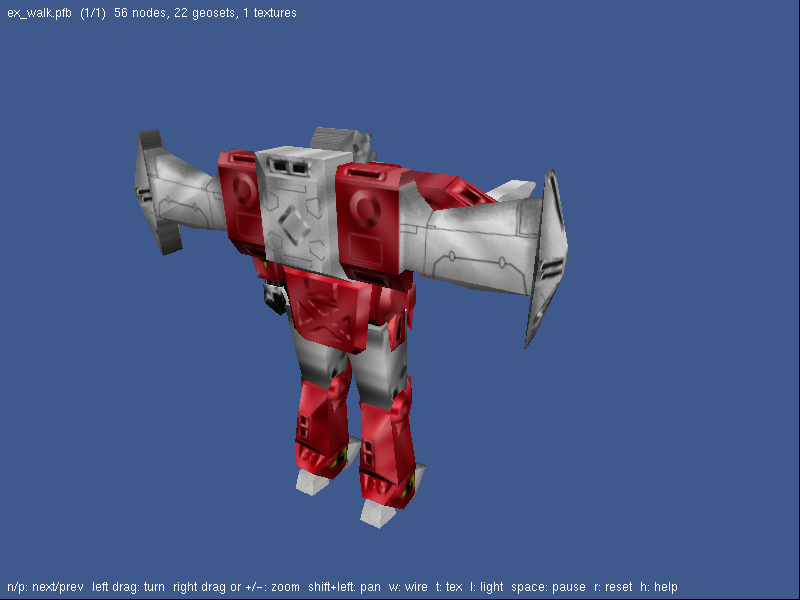

# mekton_view - viewer for the Mekton scenes



Mekton is a mech combat demo written by Silicon Graphics in 1996 on top of
IRIS Performer 2.0. Its scenes (arenas, colony, city, mechs, explosions) are
stored in Performer's binary format, `.pfb`. `mekton_view` loads and draws
them with OpenGL 1.x and GLUT. It is the first step toward a port of the game.

## How this port was made

Performer's `.pfb` format was never documented. Its layout was rebuilt from
`pfdLoadFile_pfb`, the loader linked into the IRIX `mekton_player` executable
(32-bit big-endian MIPS ELF):

- the chunk dispatch of the loader gives one reader per record type;
- each reader shows the size of its records and which Performer call
  receives each field (`pfMtlColor`, `pfGSetAttr`, `pfDCSMat`, ...);
- the translation tables in the data segment give the meaning of the file
  codes (primitive types, bindings, cull faces, alpha functions, sequence
  modes, ...).

`pfb.c` reads all the chunk types used by Mekton:

| Type | Content |
| --- | --- |
| 0 | materials |
| 1 | textures (file name and parameters) |
| 2 | texture environments |
| 3 | gstates (lighting, texturing, culling, transparency, ...) |
| 4 to 8 | lengths, coordinates, colors, normals and texture coordinates |
| 10 | geosets |
| 11 | user data (skipped) |
| 12 | nodes: Group, Geode, DCS, SCS, Switch, LOD, Sequence, Layer, Morph, ... |
| 14 | morphs |
| 21 | light point states (skipped) |

Node 0 is the root of the scene. Performer is Z up.

## What is drawn

- all primitive types, including the "flat" triangle strips whose normals and
  colors only start at the third vertex of each strip;
- overall, per primitive and per vertex bindings;
- gstates: lighting, materials, color material, textures (SGI `.rgb`, with
  mipmaps), texture environments, face culling, alpha function and
  transparency (drawn in a second pass);
- DCS and SCS transforms;
- `pfSequence` animations (explosions, turrets);
- the waterfall morph, animated with the weights used by the game in
  `update_colony`: `(1 - f, f)` with `f` the fractional part of `time / 5`.

Light points are drawn as round points. LOD nodes always show their finest
level.

## Usage

```
mekton_view [data/mekton | model.pfb ...]
```

With a directory, the viewer loads every `.pfb` of `<dir>/models` and the
textures of `<dir>/textures`. The default directory is `data/mekton`.

| Input | Action |
| --- | --- |
| `n` / `p` (or Page Down / Page Up) | next / previous model |
| Left drag, arrow keys | turn around the model |
| Right drag, mouse wheel, `+` / `-` | zoom |
| Shift + left drag, middle drag | pan |
| `w` | wireframe |
| `t` | textures on/off |
| `l` | lighting on/off |
| Space | pause the animations |
| `r` | reset the view |
| `h` | show or hide the help line |
| `Esc` / `q` | quit |

The Mekton data files (models and textures) are not part of this repository.
